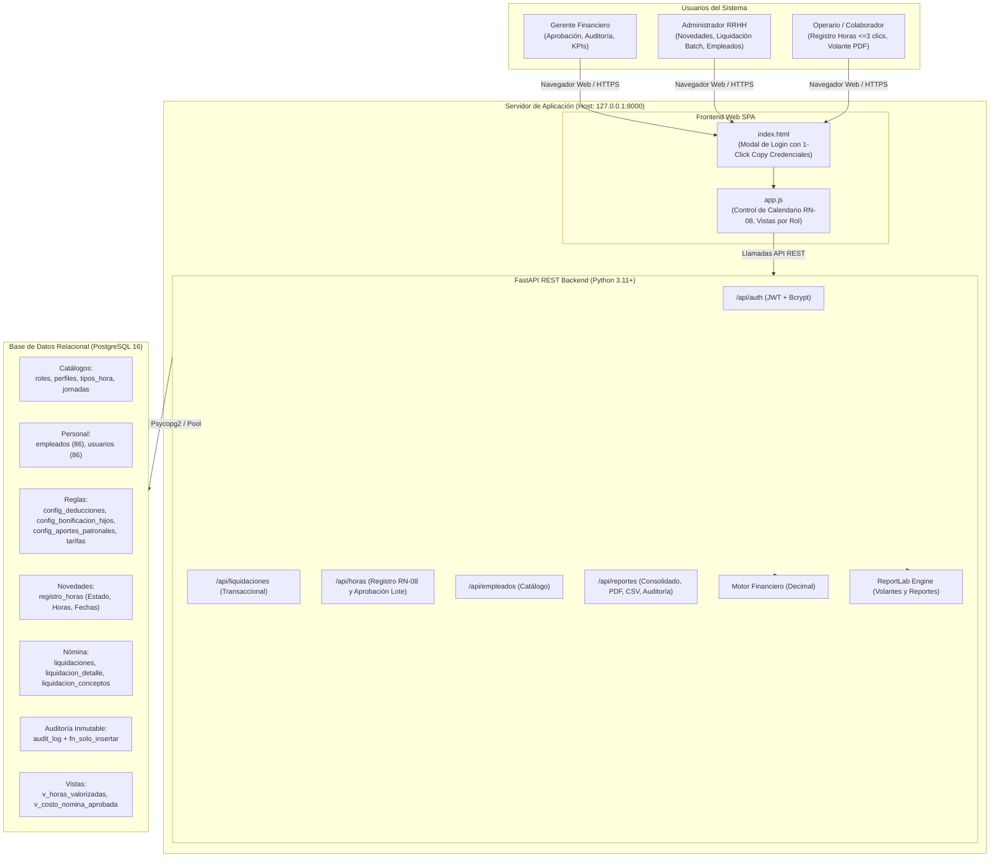

# 🏛️ Documento de Diseño de Arquitectura (C4 Model & ADRs)

## 1. Visión General
La arquitectura de **PayrollFlow** sigue un patrón desacoplado y orientado a servicios ligeros:
* **Frontend Web Responsivo:** Single Page Application (SPA) construida en HTML5, Vanilla JavaScript moderno y Tailwind CSS, servida directamente por el backend para evitar problemas de CORS y garantizar baja latencia.
* **Backend API & Motor de Cálculo:** Servicio RESTful en FastAPI (Python 3.11+) con precisión aritmética estricta mediante `Decimal` y generación nativa de documentos PDF con ReportLab.
* **Capa de Datos:** PostgreSQL 16 (desplegado localmente o mediante Docker Compose en el puerto 5435) con esquemas DDL (`01_schema.sql`) y semilla inicializada (`02_seed.sql`) para 86 colaboradores.

---

## 2. Diagrama de Arquitectura de Contenedores

---

## 3. Decisiones Arquitectónicas Clave (ADRs)

### ADR-01: PostgreSQL 16 con Precisión NUMERIC y Constraints
* **Contexto:** Las normas contables y requerimientos SENA exigen cero pérdidas o ganancias artificiales de centavos.
* **Decisión:** Usar PostgreSQL 16 con campos `NUMERIC(14,2)` y tipos `Decimal` en Python. Prohibido el uso de flotantes binarios (`FLOAT` / `REAL`).
* **Beneficio:** Consistencia matemática absoluta y cumplimiento del estándar de redondeo bancario.

### ADR-02: Aislamiento por Token JWT y Middleware RBAC
* **Contexto:** Se requiere separación rigurosa de privilegios entre Gerencia, RRHH y Operarios.
* **Decisión:** Implementar autenticación JWT en FastAPI con resolución de roles en cada invocación a endpoints protegidos.
* **Beneficio:** Imposibilidad de que un operario acceda a datos salariales de compañeros o altere tarifas empresariales.

### ADR-03: Configuración de Host Local a 127.0.0.1
* **Contexto:** Al enlazar el servidor a `0.0.0.0` en entornos Windows, los navegadores basados en Chromium (Chrome, Edge) arrojaban el error `ERR_ADDRESS_INVALID (-108)`.
* **Decisión:** Establecer por defecto `host="127.0.0.1"` en `run.py`.
* **Beneficio:** Apertura directa y transparente desde enlaces de VS Code y el navegador sin errores de resolución de red.

### ADR-04: Doble Validación Temporal de Novedades (RN-08)
* **Contexto:** Existía el riesgo de reportar horas en fechas futuras o alterar liquidaciones de meses anteriores ya cerrados.
* **Decisión:** Implementar validación en frontend restringiendo el selector de fecha (`min` al primer día del mes, `max` a hoy) y comprobación inmutable en el router de backend (`horas.py`), respondiendo HTTP 400.
* **Beneficio:** Protección integral contra manipulación de periodos en la base de datos.

---

## 4. Flujo de Datos del Ciclo de Nómina

1. **Paso 1 (Parametrización):** Tarifas por perfil y porcentajes de deducción vigentes residen en `tarifas`, `config_deducciones` y `config_bonificacion_hijos`.
2. **Paso 2 (Reporte de Novedades):** Los operarios reportan horas en el portal ($\le$ 3 clics). El backend valida que la fecha pertenezca al mes en curso y no sea futura.
3. **Paso 3 (Aprobación de Horas):** El Administrador revisa y aprueba masivamente las horas (`POST /api/horas/aprobar-lote`).
4. **Paso 4 (Cálculo Batch de Liquidación):** El Administrador dispara `POST /api/liquidaciones`. El motor transaccional procesa a los 86 colaboradores en una sola transacción SQL atómica.
5. **Paso 5 (Aprobación Gerencial):** El Gerente inspecciona el resumen ejecutivo y ejecuta la aprobación (`PATCH /api/liquidaciones/{id}/aprobar`).
6. **Paso 6 (Publicación y Descarga):** Los operarios acceden a su volante individual y pueden descargarlo en formato PDF.
